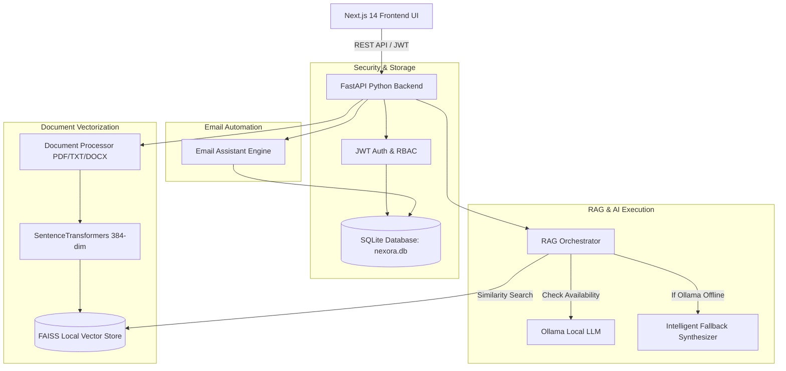

# NEXORA AI – Enterprise Knowledge Assistant with Email Automation

> **Enterprise-Grade AI Knowledge Assistant & RAG Platform** built for college projects, viva demonstrations, and enterprise policy Q&A with zero-cloud dependencies, local FAISS vector search, and dual Ollama / Fallback AI execution modes.

---

## 📌 Problem Statement
Enterprise employees frequently spend excessive time searching through long, complex HR policy documents, onboarding guides, WFH rules, and holiday lists. Standard search tools rely only on keyword matching rather than semantic understanding. Furthermore, existing cloud AI solutions (OpenAI, Pinecone, Supabase) require paid API subscriptions, external SMTP setups, and cloud hosting.

**NEXORA AI** solves this problem by providing a 100% local, privacy-focused, zero-cost Enterprise Knowledge Assistant equipped with local document vector search, role-based access control, AI email drafting, and an intelligent Fallback RAG system.

---

## 🚀 Key Features

1. **Authentication & Role-Based Access Control (RBAC)**:
   - JWT token authentication with SHA-256 / Bcrypt password hashing.
   - Three distinct enterprise roles: **Employee**, **HR Manager**, and **System Admin**.
   - Auto-seeded demo accounts on startup.

2. **Document Management & FAISS Vector Store**:
   - Multi-format upload support: **PDF**, **TXT**, **DOCX**.
   - Automated text cleaning, overlapping chunking (500 chars), and 384-dimensional vector embedding generation.
   - Fast local semantic vector search powered by **FAISS**.
   - Pre-loaded with 5 realistic sample company policy documents.

3. **RAG Chatbot with Dual Execution Modes**:
   - **Ollama Mode**: Connects directly to local Ollama server (`llama3` / `mistral`).
   - **Demo / Fallback RAG Mode**: Operates seamlessly when Ollama is offline by synthesizing structured responses with explicit document source citations.
   - **Strict Document Grounding**: Returns *"I could not find this information in the uploaded company documents."* if information is absent.

4. **AI Email Assistant & Local Demo Sending**:
   - Drafts professional enterprise emails (leave applications, WFH requests, onboarding welcome notes).
   - Real-time **Email Preview** card with subject, body, sender, and recipient fields.
   - Interactive **Edit**, **Regenerate**, and **Demo Send Email** actions (persisting emails to SQLite with *"Demo email sent successfully"* without requiring real SMTP credentials).

5. **Conversation & Audit History**:
   - SQLite persistent log of Q&A queries, retrieved sources, timestamps, and execution modes.
   - Admin audit view for monitoring enterprise interactions.

6. **Admin User Management**:
   - Create new users, grant/change roles dynamically, and activate/deactivate user access.

---

## 🏗️ Architecture & RAG Flow



---

## 🛠️ Technology Stack

| Layer | Technology Used | Description |
| :--- | :--- | :--- |
| **Frontend** | Next.js 14 (React, TypeScript) | Modern glassmorphism UI design system |
| **Styling** | Vanilla CSS + CSS Modules | Sleek dark enterprise design with micro-animations |
| **Backend** | Python FastAPI + Uvicorn | High-performance asynchronous REST API |
| **Database** | SQLite + SQLAlchemy | Zero-configuration local relational database |
| **Authentication** | PyJWT + Password Hashing | Role-Based Access Control (Employee, HR, Admin) |
| **Vector DB** | FAISS (Facebook AI Similarity Search) | High-speed local similarity vector search |
| **Embeddings** | SentenceTransformers (`all-MiniLM-L6-v2`) | 384-dimensional vector representation |
| **LLM Engine** | Ollama (`llama3`) + Fallback RAG Engine | Local AI generation with 100% offline fallback |

---

## 🔑 Demo Login Credentials

The application automatically seeds three demo accounts upon backend startup:

| Role | Email Address | Password | Permissions |
| :--- | :--- | :--- | :--- |
| **Employee** | `employee@nexora.local` | `employee123` | Ask RAG Chat, View Documents, Draft Email, View History |
| **HR Manager** | `hr@nexora.local` | `hr123` | Employee rights + Upload Documents & Manage Policy Files |
| **Admin** | `admin@nexora.local` | `admin123` | Full access + Delete Docs, Manage Users & View Audit Logs |

---

## 📁 Project Folder Structure

```
c:\Users\skaps\Downloads\Next\
├── sample_documents/           # Pre-loaded company policy documents
│   ├── HR Leave Policy.txt
│   ├── Employee Onboarding.txt
│   ├── Work From Home Policy.txt
│   ├── Company Holiday Policy.txt
│   └── Employee Code of Conduct.txt
├── backend/                    # Python FastAPI Backend
│   ├── main.py                 # App entry point, CORS, startup seeding
│   ├── database.py             # SQLite connection & session
│   ├── models.py               # SQLAlchemy ORM models
│   ├── auth.py                 # JWT token generation & RBAC dependencies
│   ├── requirements.txt        # Python package manifest
│   ├── rag/                    # RAG Engine Module
│   │   ├── document_processor.py  # PDF/TXT/DOCX extraction & chunking
│   │   ├── embeddings.py          # SentenceTransformer vectorizer
│   │   ├── vector_store.py        # FAISS index manager
│   │   └── rag_pipeline.py        # RAG pipeline & Fallback synthesizer
│   └── routes/                 # API Endpoints
│       ├── auth.py, documents.py, chat.py, email.py, users.py, etc.
├── frontend/                   # Next.js 14 Frontend UI
│   ├── app/                    # Next.js App Router pages
│   ├── components/             # Sidebar, Navbar, Glass cards
│   ├── lib/                    # API client & AuthContext
│   ├── package.json
│   └── tsconfig.json
├── .env.example
├── .gitignore
└── README.md
```

---

## ⚙️ Quick Start & Execution Guide

### 1. Prerequisites
- **Python 3.10+** installed
- **Node.js 18+** installed
- *(Optional)* **Ollama** installed locally if you want to connect local LLM models.

### 2. Backend Setup & Run
Open a terminal in the project root:
```bash
# Install Python dependencies
pip install pyjwt passlib bcrypt pypdf python-docx fastapi uvicorn sqlalchemy requests python-multipart numpy

# Start the FastAPI Backend Server
python backend/main.py
```
*The backend API will start at `http://localhost:8008` and automatically seed demo users and sample documents into FAISS.*

### 3. Frontend Setup & Run
Open a second terminal window:
```bash
# Navigate to frontend folder
cd frontend

# Install dependencies (if not already installed)
npm install

# Run Next.js Development Server
npm run dev
```
*Open your browser and navigate to `http://localhost:3000`.*

---

## 🎓 Viva Exam Questions & Answers (Cheat Sheet)

### Q1: How does the RAG Pipeline work in NEXORA AI?
> **Answer**: When a user asks a question (e.g., *"What is the leave policy?"*), the query is converted into a 384-dimensional vector embedding. FAISS performs a cosine similarity search against indexed document chunks stored in memory. The top relevant chunks are retrieved and sent to Ollama or formatted via our Fallback RAG synthesizer to generate an accurate response grounded strictly in company policies.

### Q2: What happens if Ollama is not installed on the system?
> **Answer**: NEXORA AI features an **Intelligent Fallback Engine**. It executes the full vector retrieval pipeline using FAISS and extracts the most relevant policy text chunks, formatting a structured answer with clear source citations so the application functions 100% offline without any external LLM service.

### Q3: Why use FAISS over traditional keyword search?
> **Answer**: Traditional keyword search fails when synonyms or different phrasings are used. FAISS evaluates **semantic vector distance**, finding relevant content based on contextual meaning rather than exact word matching.

---

## ⚡ API Endpoint Reference

- `POST /auth/login` – User authentication & JWT issuance
- `POST /auth/register` – User self-registration
- `GET /documents` – List indexed policy files
- `POST /documents/upload` – Upload & vectorize PDF/TXT/DOCX document (HR/Admin)
- `POST /chat` – Execute RAG query against FAISS & return answer + sources
- `GET /chat/status` – Query Ollama vs Demo Mode system status
- `POST /email/generate` – Generate AI email preview draft
- `POST /email/demo-send` – Simulate local email dispatch (SQLite record)
- `GET /users` – List & manage user role accounts (Admin only)
- `GET /dashboard/stats` – Fetch card metrics & recent activity feed

---

## 🏁 Conclusion
NEXORA AI provides a complete, modern, enterprise-grade AI knowledge platform tailored for college demonstrations, viva exams, and privacy-conscious organizations. It combines low-latency local vector search with flexible AI execution and sleek user experience.
